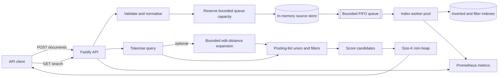
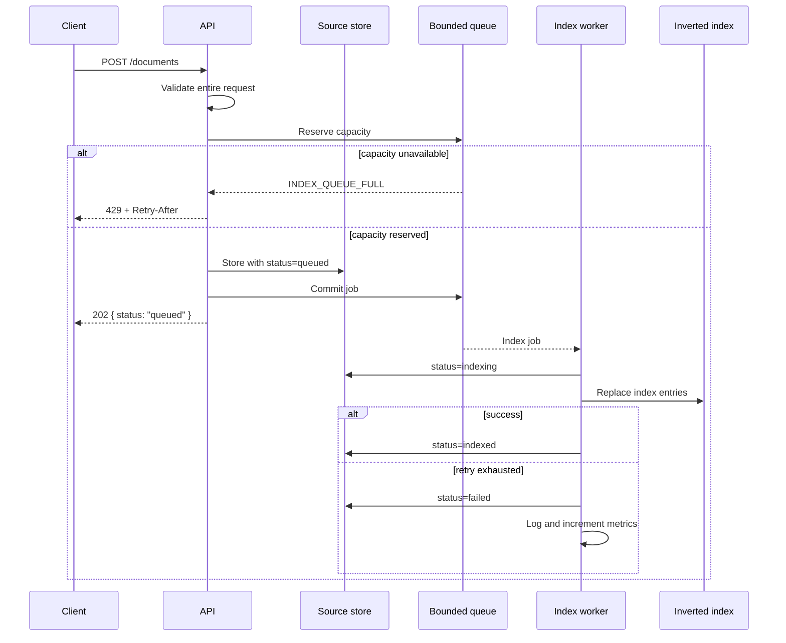
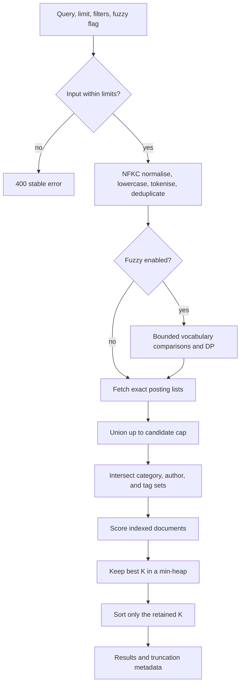
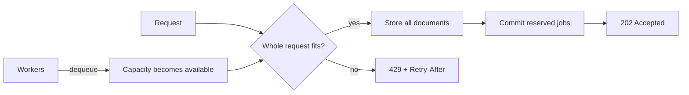
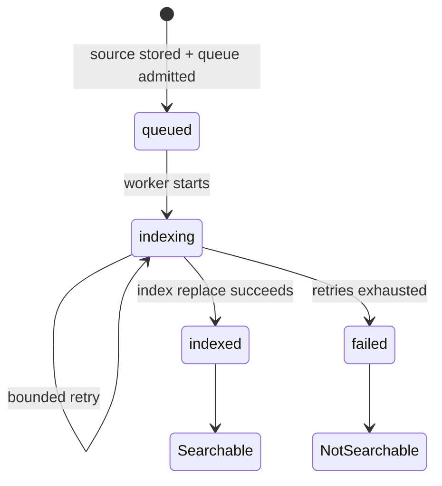
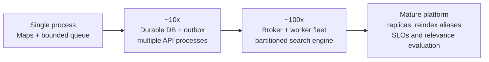

# Content Search + Top-K Ranking

A standalone Node.js/TypeScript service that makes the mechanics of search visible: asynchronous indexing, an inverted index, deterministic relevance scoring, bounded fuzzy matching, and heap-based Top-K selection.

This is deliberately an educational system rather than a wrapper around a search engine. It answers the engineering questions that a production search design should make explicit:

- Why not scan every document for every query? Repeated work is moved to an index built once at write time.
- Why not sort every matching document? A size-`K` heap avoids sorting results that will be discarded.
- Why not use dynamic programming everywhere? Edit distance has overlapping subproblems; exact term lookup does not.
- What happens after a write? The API safely stores and queues it, returns `202 Accepted`, and an asynchronous worker makes it searchable.
- What happens under overload? Work is bounded and rejected with `429`, rather than growing memory without limit.

## System design



The source store owns accepted documents and indexing state. The index is a derived, rebuildable read model. This separation is important: accepting a document and making it searchable are different operations with different failure modes.

### Write and indexing sequence



Bulk ingestion validates every document, checks every ID, and reserves capacity for the whole batch before storing anything. A malformed, duplicate, or oversized batch does not partially mutate state.

### What `202 Accepted` means

`202` is returned only after the request has been validated, the source record has been stored, and bounded queue admission has succeeded. It does **not** mean indexing has completed. Until the worker marks the document `indexed`, search intentionally excludes it.

The intended follow-up process is:

1. The client receives the document ID and `status: "queued"`.
2. A worker changes the internal state from `queued` to `indexing`, then to `indexed` or `failed`.
3. Search becomes eventually consistent after the `indexed` transition.
4. A client that needs read-after-write behavior can retry its search with capped exponential backoff and jitter.

This scoped API does not expose `GET /documents/:id/status`; `/health` is operational health, not a per-document receipt. A production API should return a `Location` header and add a status resource, publish a completion event/webhook, or choose synchronous indexing for workflows that truly require immediate visibility. With the current process-local store, a restart loses both documents and outstanding jobs.

### Search sequence



## Quick start

Requirements: Node.js `24.21.0` and npm `11.19.0`. Exact application and tooling versions are pinned in `package.json` and `package-lock.json` for reproducible builds.

```bash
nvm use
npm ci
npm run typecheck
npm test -- --runInBand
npm run build
npm start
```

The service listens on `http://localhost:3000` by default.

With Docker:

```bash
docker compose up --build --wait
curl --fail http://localhost:3000/health
docker compose down
```

The runtime image is non-root, read-only, uses an init process, has a health check, and contains production dependencies plus compiled JavaScript only.

## API

### Add one document

```bash
curl --include --request POST http://localhost:3000/documents \
  --header 'content-type: application/json' \
  --data '{
    "id": "doc-1",
    "title": "Building a bounded search service",
    "body": "Inverted indexes avoid scanning every document at query time.",
    "tags": ["node", "search"],
    "category": "engineering",
    "author": "ada",
    "popularity": 250
  }'
```

```http
HTTP/1.1 202 Accepted

{"id":"doc-1","status":"queued"}
```

`id`, `title`, and `body` are required non-empty strings. `tags` defaults to `[]`, `popularity` defaults to `0`, and `category` and `author` are optional. Duplicate IDs return `409`.

### Add documents atomically

```bash
curl --request POST http://localhost:3000/documents/bulk \
  --header 'content-type: application/json' \
  --data '{"documents":[
    {"id":"doc-2","title":"Top-K heaps","body":"Retain only the best K candidates."},
    {"id":"doc-3","title":"Edit distance","body":"A bounded fuzzy-search primitive."}
  ]}'
```

The response is `202` with all accepted IDs. Default maximum batch size is 100. Empty, malformed, duplicate, or capacity-exceeding batches make no partial changes.

### Search

```bash
curl --get http://localhost:3000/search \
  --data-urlencode 'q=node search' \
  --data-urlencode 'limit=10' \
  --data-urlencode 'category=engineering' \
  --data-urlencode 'author=ada' \
  --data-urlencode 'tag=node' \
  --data-urlencode 'tag=search'
```

Repeated `tag` filters use AND semantics. Category and author filters are also ANDed. Matching and filters are case-normalised. An empty `q` is valid and returns no results.

Fuzzy search is opt-in:

```bash
curl --get http://localhost:3000/search \
  --data-urlencode 'q=serch' \
  --data-urlencode 'fuzzy=true' \
  --data-urlencode 'limit=5'
```

A response contains the original query, exact query terms, candidate counts, elapsed time, ranked documents, per-component score explanations, and explicit truncation metadata. Fuzzy responses also report comparisons, expansions, and whether a fuzzy bound was reached.

```json
{
  "query": "node search",
  "terms": ["node", "search"],
  "totalCandidates": 3,
  "consideredCandidates": 2,
  "tookMs": 0.42,
  "results": [
    {
      "document": {"id": "doc-1", "title": "...", "body": "...", "tags": ["node"], "popularity": 250},
      "score": 10.37,
      "explanation": {
        "coverage": 4,
        "termFrequency": 2.08,
        "titleBoost": 4,
        "tagBoost": 0,
        "popularity": 0.29,
        "total": 10.37
      }
    }
  ],
  "candidatesTruncated": false
}
```

### Health and metrics

```bash
curl http://localhost:3000/health
curl http://localhost:3000/metrics
```

`/health` returns HTTP `200` with `status: "ok"` or `"degraded"`, queue depth/capacity/utilisation, active workers, and terminal indexing failures. Degraded means the queue is at least 80% utilised or an indexing job has exhausted retries. It is a liveness and saturation signal; deployments that require separate readiness should map the body to their own policy.

`/metrics` uses the Prometheus exposition format.

### Error contract

Errors have a stable machine-readable shape:

```json
{
  "error": {
    "code": "INDEX_QUEUE_FULL",
    "message": "The indexing queue has no capacity for 1 additional job",
    "details": {"capacity": 1000, "depth": 1000, "requested": 1, "reserved": 0}
  }
}
```

| Status | Meaning |
| --- | --- |
| `400` | Invalid document, query, filter, limit, fuzzy flag, or bulk request |
| `409` | Duplicate ID in the store or within one batch |
| `429` | Bounded indexing queue cannot admit the entire request; includes `Retry-After: 1` |
| `503` | Queue is closed during shutdown |
| `500` | Invalid startup configuration or unexpected internal error |

## Data model and indexing

The source store is `Map<documentId, StoredDocument>`. Documents contain:

| Field | Required | Notes |
| --- | --- | --- |
| `id` | yes | Unique, trimmed string |
| `title` | yes | Searchable and receives a ranking boost |
| `body` | yes | Searchable text |
| `tags` | no | Searchable, filterable, deduplicated, lowercased |
| `category` | no | Case-normalised exact filter |
| `author` | no | Case-normalised exact filter |
| `popularity` | no | Finite non-negative number, logarithmically normalised |

Text is Unicode NFKC-normalised, lowercased with the English locale, and split into Unicode letter/number tokens. This is intentionally simple and deterministic; it does not provide language-specific stemming, stop words, synonyms, phrase positions, or CJK segmentation.

Each successful indexing operation replaces the document's prior derived state:

- `Map<term, Map<documentId, frequency>>` for term-to-document lookup.
- Per-document term-frequency maps for scoring and safe replacement/removal.
- `Set`s for title terms and tag terms, used by ranking boosts.
- `Map<normalisedFilter, Set<documentId>>` for tags, category, and author.

Public index accessors return defensive copies so callers cannot mutate index invariants.

## Why these data structures

| Need | Structure | Typical cost | Reason |
| --- | --- | --- | --- |
| Source lookup | `Map<id, document>` | `O(1)` average | Identity, duplicate detection, worker lookup |
| Term lookup | Nested `Map` posting list | `O(1)` average term lookup, then `O(P)` traversal | Avoids `O(N)` document scans |
| Deduplication | `Set` | `O(1)` average membership | Unique terms, tags, and candidates |
| Exact filters | `Map<value, Set<id>>` | `O(1)` lookup plus intersection | Starts with the smallest filter set |
| Work admission | Bounded FIFO array/consumer waiters | `O(1)` append; current `shift` is `O(n)` | Clear backpressure semantics; a ring buffer is the next optimisation |
| Top-K | Custom binary min-heap | `O(C log K)` | Bounds selection memory and avoids `O(C log C)` full sort |
| Fuzzy distance | Two DP rows | `O(mn)` time, `O(min(m,n))` memory | Exact Levenshtein distance without a full matrix |

The queue's array `shift()` is acceptable at the configured educational scale, but is an intentional hotspot: replace it with a head-indexed deque/ring buffer before substantially increasing capacity.

## Candidate generation, ranking, and Top-K

Exact candidate generation unions posting lists for all unique query terms. Filters are then intersected in ascending filter-set size. Candidate admission stops at `MAX_CANDIDATES` and reports `candidatesTruncated: true`; the service never silently implies exhaustive ranking after a safety bound is reached.

For a document `d` and unique query terms `Q`, the score is:

```text
score(d, Q) =
    4 * matchedTerms / |Q|
  + 1 * ln(1 + matchedTermFrequency)
  + 2 * matchedTitleTerms
  + 1 * matchedTagTerms
  + 1 * min(1, ln(1 + popularity) / ln(1 + 1,000,000))
```

The default weights live in `src/ranking/ranker.ts`. Every component is returned in `explanation`, which makes tuning inspectable. Equal scores are ordered by document ID, so output is deterministic.

After scoring `C` candidates, a min-heap retains only the best `K`. The heap root is the worst retained result; a better candidate replaces it. Only those `K` values are sorted for the final response.

| Stage | Time | Additional space |
| --- | --- | --- |
| Tokenise query | `O(Qchars)` | `O(Qterms)` |
| Exact posting traversal | `O(sum(Pi))` | `O(min(C, candidateCap))` |
| Filter intersection | `O(C * F)` worst case | `O(C)` |
| Score candidates | `O(C * Qterms)` | `O(C)` in the current implementation |
| Top-K selection | `O(C log K + K log K)` | `O(K)` inside selection |
| Index one document | `O(T)` average | `O(U)` derived entries |

`Pᵢ` is the size of a query-term posting list, `F` is the filter count, `T` is the document token count, and `U` is its unique-term count. The current search code materialises scored results before Top-K; streaming scores directly into the heap would reduce end-to-end selection memory from `O(C)` to `O(K)`.

## Fuzzy search and dynamic programming

Fuzzy matching runs only when `fuzzy=true`, and only for query terms without an exact posting. It scans a sorted, bounded slice of the vocabulary and uses Levenshtein edit distance.

For prefixes `a[0..i)` and `b[0..j)`, define `D(i,j)` as their minimum edit distance:

```text
D(0, j) = j
D(i, 0) = i
D(i, j) = min(
  D(i-1, j)   + 1,                    // deletion
  D(i, j-1)   + 1,                    // insertion
  D(i-1, j-1) + (a[i-1] == b[j-1] ? 0 : 1) // substitution
)
```

This is bottom-up dynamic programming because the recurrence repeatedly needs the same smaller prefix states. Only the previous and current row are retained, giving `O(mn)` time and `O(min(m,n))` space. A length difference already greater than the permitted distance exits early; distances over the configured maximum are returned as the bounded sentinel `maxDistance + 1`.

Exact lookup does not use DP: a hash-map lookup has no overlapping recursive subproblems to memoise. Adding a DP table there would add work without changing the answer.

Fuzzy work is constrained independently by:

- maximum query-term length;
- maximum vocabulary comparisons per request;
- maximum total expansions;
- maximum edit distance; and
- a wall-clock expansion deadline.

The response exposes `fuzzy.truncated`, `comparisons`, and `expansions`, so degraded recall is visible to callers.

## Backpressure, consistency, and failure handling



Queue reservations prevent a race where two concurrent bulk requests each observe enough free capacity. Capacity includes queued plus reserved work. Producers never wait indefinitely and the queue never expands beyond its configured limit.



Index replacement removes old postings before adding the new derived state. On terminal failure, the source record remains with `failed` status, the failure is logged without document body/query text, metrics are incremented, and health becomes degraded. A worker-pool rebuild operation can clear and deterministically reconstruct the index from source records. In this in-memory version a process restart loses the source too; production recovery requires durable storage and a durable job log.

The pool has fixed concurrency, retries indexing once by default, and stops accepting work when closed. Search never returns `queued`, `indexing`, or `failed` records, preventing a partially indexed document from leaking into results.

## Resource limits and configuration

All numeric environment variables are parsed as bounded safe integers at startup. Invalid configuration fails fast.

| Variable | Default | Purpose |
| --- | ---: | --- |
| `HOST` | `0.0.0.0` | Listen address |
| `PORT` | `3000` | Listen port |
| `MAX_DOCUMENT_ID_LENGTH` | `128` | ID characters |
| `MAX_DOCUMENT_TITLE_LENGTH` | `512` | Title characters |
| `MAX_DOCUMENT_BODY_LENGTH` | `100000` | Body characters |
| `MAX_DOCUMENT_TAGS` | `50` | Tags per document |
| `MAX_DOCUMENT_TAG_LENGTH` | `64` | Tag characters |
| `MAX_DOCUMENT_CATEGORY_LENGTH` | `128` | Category characters |
| `MAX_DOCUMENT_AUTHOR_LENGTH` | `128` | Author characters |
| `MAX_DOCUMENT_POPULARITY` | `1000000` | Maximum accepted popularity |
| `MAX_QUERY_LENGTH` | `512` | Query characters |
| `MAX_SEARCH_TERMS` | `16` | Unique terms per query |
| `MAX_CANDIDATES` | `10000` | Candidate set bound |
| `MAX_TOP_K` | `100` | Maximum result limit |
| `MAX_FUZZY_TERM_LENGTH` | `32` | Unicode code points per fuzzy term |
| `MAX_FUZZY_COMPARISONS` | `500` | Vocabulary comparisons per request |
| `MAX_FUZZY_EXPANSIONS` | `5` | Total fuzzy expansions per request |
| `MAX_FUZZY_DISTANCE` | `2` | Accepted Levenshtein distance |
| `FUZZY_DEADLINE_MS` | `25` | Fuzzy expansion time budget |
| `MAX_BULK_SIZE` | `100` | Documents in one bulk call |
| `INDEX_QUEUE_CAPACITY` | `1000` | Queued plus reserved jobs |
| `INDEXING_CONCURRENCY` | `4` | Fixed worker count |
| `MAX_INDEX_RETRIES` | `1` | Retries after the first attempt |
| `SHUTDOWN_TIMEOUT_MS` | `5000` | Validated shutdown budget reserved for a durable-worker integration |

The last setting is intentionally not presented as a guarantee: the current in-process worker has no cancellable external I/O and closes by awaiting its active loop. A production worker should enforce this budget around broker acknowledgement and drain operations.

## Observability

Fastify/Pino structured logs cover completed searches and terminal indexing failures. Search logs include mode, term count, candidate/result counts, and duration—not raw queries or document bodies. The error handler returns generic `500` responses and logs unexpected errors server-side.

Custom Prometheus metrics:

| Metric | Type | Purpose |
| --- | --- | --- |
| `search_requests_total{mode,status}` | counter | Exact/fuzzy request outcomes |
| `search_latency_seconds{mode}` | histogram | End-to-end search latency |
| `ranking_latency_seconds` | histogram | Ranking plus Top-K time |
| `fuzzy_search_latency_seconds` | histogram | Vocabulary expansion and DP time |
| `index_documents_total{status}` | counter | Accepted/indexed/retry/failed lifecycle events |
| `index_queue_depth` | gauge | Current waiting jobs |
| `index_queue_rejections_total` | counter | Admission rejections |
| `index_active_workers` | gauge | Workers currently indexing |
| `service_errors_total{component,code}` | counter | Bounded failures by stable code |

The maintained official Prometheus JavaScript client also exports Node.js process metrics. Useful alerts include sustained queue utilisation, any growing terminal-failure counter, error-rate changes, and p95/p99 latency from histogram buckets.

## Testing

```bash
npm test -- --runInBand
npm run test:coverage -- --runInBand
```

The suite contains 102 deterministic Jest tests across 20 suites. It covers validation, atomic storage, tokenisation, defensive index behavior, filters, ranking ties, Top-K equivalence, DP boundaries, fuzzy truncation, every configured resource limit, queue reservation races, retry/failure transitions, eventual consistency, metrics, health, and API contracts.

Coverage gates are enforced globally at 90% statements, 85% branches, 90% functions, and 90% lines. The last verified run reached 95.52% statements, 90.90% branches, 97.45% functions, and 95.48% lines.

CI runs a clean install, type checking, all tests, compilation, and a production dependency audit on pushes to `main` and pull requests.

## Load testing

Start the compiled service, seed data, then run a scenario:

```bash
npm run build
npm start

# In another terminal
DOCUMENTS=10000 npm run load:seed
DURATION=30 CONNECTIONS=50 npm run load:search
```

Available scripts isolate different costs:

| Command | Pressure tested |
| --- | --- |
| `npm run load:search` | Exact search and ranking |
| `npm run load:index` | Single-document ingestion |
| `npm run load:mixed` | Concurrent reads and writes |
| `npm run load:large-query` | Query-term/input bounds |
| `npm run load:many-candidates` | Candidate cap and Top-K |
| `npm run load:bulk` | Atomic bulk admission and backpressure |
| `npm run load:fuzzy` | Vocabulary scan and DP bounds |

All use Autocannon and accept `BASE_URL`, `DURATION`, `CONNECTIONS`, `PIPELINING`, and `TIMEOUT`. Each prints throughput, p50, an explicitly labelled conservative p95 upper bound, p99, errors, non-2xx responses, and a metrics snapshot. Autocannon exposes p97.5 rather than p95, so `p95UpperBoundMs` deliberately reports p97.5 instead of inventing a percentile.

One local smoke run after seeding 20 documents produced 7,823 searches in two seconds: about 3,911 requests/second, p50 0 ms, p95 upper bound 0 ms, p99 4 ms, and no errors/non-2xx responses. That is a developer-machine sanity check, not a capacity claim. Publish repeatable results only with hardware, dataset shape, process count, warm-up, duration, and commit SHA recorded.

## Build versus buy

The custom structures are useful when the goal is to demonstrate internals, keep dependencies small, or enforce very specific bounded behavior. They are not automatically the best business choice.

Package versions below were evaluated on 2026-10-09; verify compatibility and maintenance again at adoption time.

### In-process npm options

| Option | What it replaces | Benefits | Trade-offs / adoption trigger |
| --- | --- | --- | --- |
| Current custom index + heap + DP | Nothing | Full control, transparent complexity, no hidden unbounded work | More code to validate; retain for learning or unusually specific semantics |
| [MiniSearch 7.2.0](https://www.npmjs.com/package/minisearch) | Tokenisation, in-memory index, ranking, prefix/fuzzy search | Mature compact feature set and no runtime dependencies | Ranking/index behavior becomes library-defined; adopt when product features matter more than demonstrating internals |
| [Fuse.js 7.5.0](https://www.npmjs.com/package/fuse.js) | Fuzzy matching/ranking for small collections | Zero dependency, straightforward approximate search | Typically scans a collection and is not a durable distributed index; good for small client/in-process datasets |
| [Lunr 2.3.9](https://www.npmjs.com/package/lunr) | Local full-text index | Familiar inverted-index API and serialisable indexes | Older release cadence; check maintenance/security posture before choosing it |
| [@datastructures-js/priority-queue 6.4.0](https://www.npmjs.com/package/@datastructures-js/priority-queue) | Custom heap only | Removes low-level heap maintenance | Adds a dependency while leaving indexing, ranking, and bounds to this service |

Typesense and Meilisearch npm packages are API clients, not embedded search engines. Installing the client does not remove the need to run their server or managed service.

### Storage and search services

| Option | What it simplifies | Control/cost given up | Good adoption trigger |
| --- | --- | --- | --- |
| [PostgreSQL full-text search](https://www.postgresql.org/docs/current/textsearch.html) | Durable source data, transactional writes, `tsvector`/`tsquery`, indexes and ranking | Less specialised relevance/fuzzy tooling than dedicated engines | Data already lives in Postgres and search scale/relevance are moderate |
| [SQLite FTS5](https://www.sqlite.org/fts5.html) | Durable single-node full-text index with BM25/highlight/snippet | Limited horizontal write/search scaling | Embedded, desktop, edge, or single-instance deployments |
| [OpenSearch](https://docs.opensearch.org/latest/search-plugins/) | Distributed indexing/search, analyzers, aggregations, vector and operational tooling | Cluster cost and operational complexity; relevance/config are engine-specific | Search is a core workload requiring shards, replicas, rich queries, and scale-out |
| [Elasticsearch](https://www.elastic.co/docs/get-started) | Distributed Lucene search, mature query DSL, analyzers, observability ecosystem | Infrastructure/licensing/cost considerations and less application-level control | Rich relevance, analytics, near-real-time distributed search, managed operations |
| [Typesense](https://typesense.org/docs/) | Typo-tolerant search, filtering, simpler operational model, hosted option | Service dependency and Typesense ranking/schema model | Product search/autocomplete needs fast delivery with fewer knobs than Lucene systems |
| [Meilisearch](https://www.meilisearch.com/docs/learn/relevancy/typo_tolerance_settings) | Typo tolerance and user-facing relevance defaults, hosted/self-hosted options | Service dependency and engine-specific ranking constraints | Fast product iteration and good defaults outweigh bespoke algorithms |

A common pragmatic path is PostgreSQL first, then a change-data-capture/outbox pipeline into a dedicated search service when relevance, query volume, or independent scaling justifies it.

## Scaling path



### Around 10x

1. Put source documents and idempotency keys in PostgreSQL.
2. Write an outbox record in the same transaction as the document.
3. Move indexing to separate workers consuming a durable broker.
4. Replace the array queue with the broker's bounded prefetch and retry/dead-letter policy.
5. Add `GET /documents/:id/status`, a completion event, and request idempotency.
6. Stream scores into Top-K and use a ring buffer wherever an in-process queue remains.
7. Run multiple stateless API instances; expose distinct readiness/liveness endpoints.

### Around 100x or richer search requirements

1. Move postings and relevance execution to PostgreSQL FTS, OpenSearch, Elasticsearch, Typesense, or Meilisearch based on measured requirements.
2. Partition by tenant/corpus, add replicas, and design explicit routing and failure domains.
3. Version index schemas and use dual-write/reindex aliases for zero-downtime migrations.
4. Add language analyzers, synonyms, phrase/field queries, pagination/search-after, and offline relevance judgments.
5. Cache safe popular queries, rate-limit by tenant, and enforce workload-specific timeouts.
6. Define SLOs for acceptance, indexing lag, search latency, availability, and recall degradation.
7. Add tracing across API, broker, worker, source database, and search engine.

Scale based on observed posting-list size, candidate distribution, indexing lag, heap/CPU profiles, and relevance needs—not document count alone.

## Production review

### What is intentionally strong here

- Safe admission order: capacity reservation precedes source mutation; `202` follows store plus queue commit.
- Atomic bulk behavior and deterministic duplicate handling.
- No per-request unbounded collection: query, term, candidate, Top-K, fuzzy, bulk, queue, and concurrency limits are explicit.
- Index is derived from a source of truth and has a deterministic rebuild path.
- Ranking is explainable and tie-breaking is stable.
- Fuzzy DP, candidate truncation, queue overload, retries, and failures are observable.
- Production image, Compose health check, CI, tests, coverage gates, load scenarios, and structured logs are included.

### What must change before real production use

- Replace the process-local source and queue with durable, replicated systems. Current restart behavior loses all data.
- Add authentication/authorisation, tenant isolation, TLS at the edge, rate limiting, CORS policy, request IDs, and audit controls.
- Add a per-document status API or completion notification and define indexing-lag guarantees.
- Make writes idempotent and decide update/delete/version conflict semantics. This API is create-only.
- Avoid returning full bodies if documents can be large or sensitive; add projections/snippets and pagination.
- Add schema migration/reindex procedures, backups, restore tests, and disaster-recovery targets.
- Separate liveness from readiness and enforce a truly bounded, cancellable graceful-shutdown protocol around external workers.
- Benchmark realistic languages, corpus distributions, hot terms, filters, and multi-tenant noisy-neighbour cases.
- Establish offline relevance evaluation before tuning weights or adopting ML/vector ranking.

### Dependency and security posture

The last production-only audit (`npm audit --omit=dev --audit-level=moderate`) reported zero vulnerabilities. The full development tree reported 22 moderate findings in Jest/Autocannon transitive tooling; npm's forced remediation proposed major downgrades, so it was not applied. These tools are excluded from the runtime image. Re-evaluate advisories regularly and upgrade when compatible fixes are available rather than suppressing or force-downgrading blindly.

## Project layout

```text
src/
  algorithms/       custom edit distance and min-heap
  api/              HTTP routes and error mapping
  domain/           document model, validation, source store
  index/            tokenizer, inverted index, bounded queue, workers
  metrics/          private Prometheus registry and instruments
  ranking/          explainable scoring
  search/           candidate generation, filters, fuzzy expansion
  app.ts            dependency composition
  config.ts         bounded environment configuration
  server.ts         process entry point and signal handling
tests/               unit, integration, consistency, and API tests
load-tests/          Autocannon scenarios and metrics snapshots
.github/workflows/   reproducible CI verification
Dockerfile           tested multi-stage production image
docker-compose.yml   local runtime and health check
```

## Final decision summary

- **Indexing:** inverted index, not full scans, because repeated query-time work dominates as the corpus grows.
- **Top-K:** size-`K` heap, not a full candidate sort, because callers discard everything after `K`.
- **Fuzzy:** opt-in bounded Levenshtein DP, not fuzzy work on every query.
- **Writes:** `202 Accepted` after safe source-store and queue admission, with explicit eventual consistency.
- **Overload:** finite queue and `429`, not implicit buffering.
- **State:** source is authoritative; index is derived and rebuildable.
- **Build versus buy:** custom code is justified for this educational brief; a durable database and established search engine are the default recommendation once this becomes a real product.

## License

[MIT](LICENSE)
